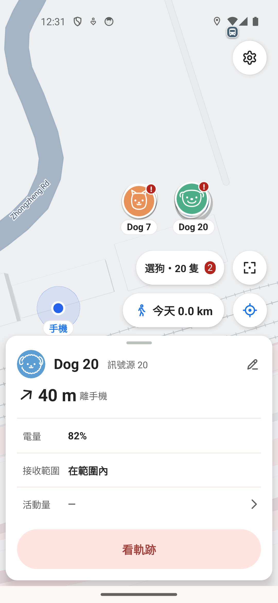
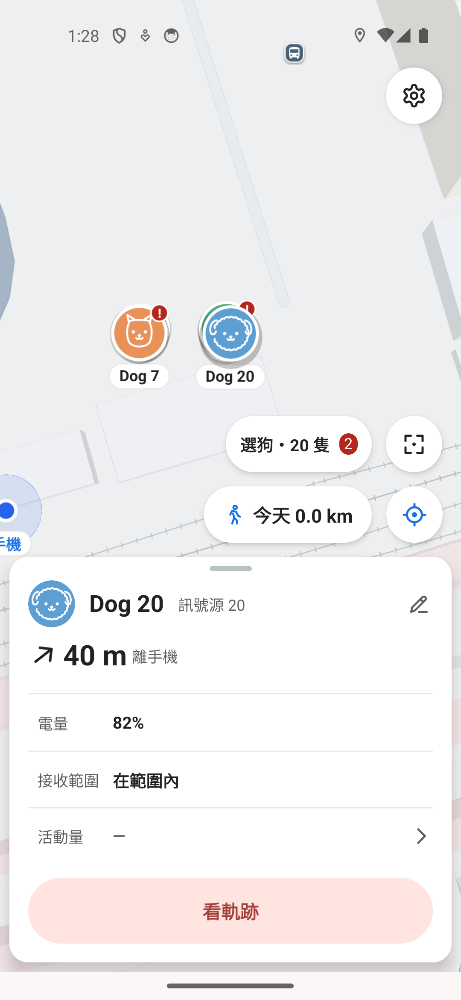
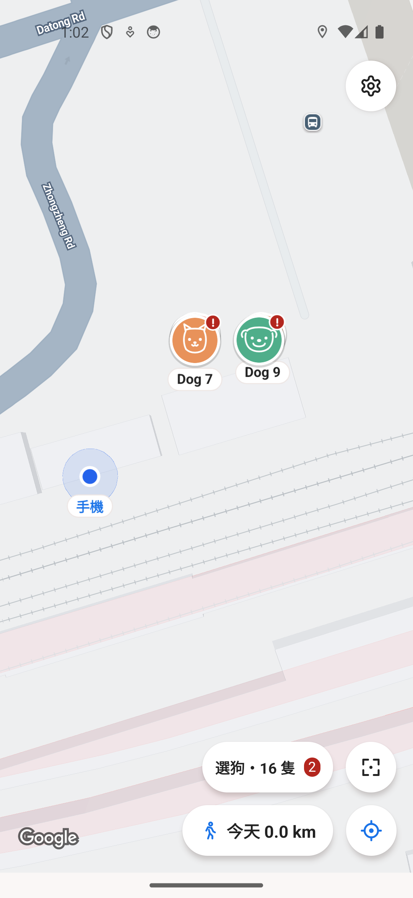
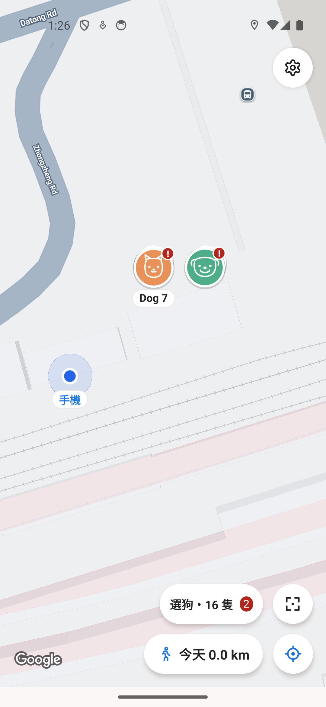
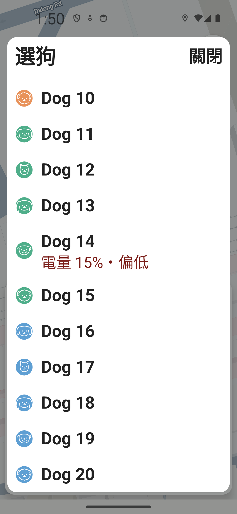
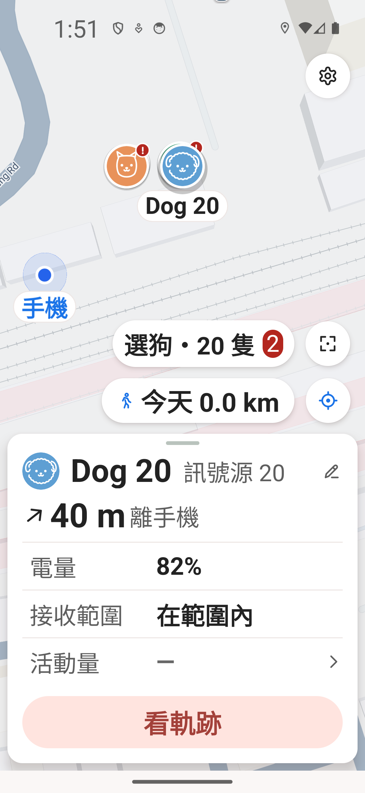

# PR113 密集狗設計與原生驗證

這個候選延續 PR108 恢復的底部名字。多隻狗貼在一起時，優先顯示選中狗的名字，其他名字遇到重疊或下方控制項便省略。使用者明確按「選狗」才開清單；點可見頭像仍直接開那隻狗的卡片，平移／縮放不會自動改成清單。狗的位置保持原座標，不為排版移動頭像。

## 選狗入口圖示調整（來源完成，原生圖待補）

依使用者最新指定，地圖入口改為單一「清單＋狗」向量圖示，與其他浮動按鈕同為48dp圓形觸控範圍。入口不再顯示文字、狗數或問題數；TalkBack仍完整朗讀選狗、總數及需注意數。清單內的標題、狗名及狀態保留。點圖示才開清單；頭像始終開自己的卡片，縮放不改點擊語意。

下方既有原生圖片驗證的是先前文字入口，尚不能當新圖示的原生排版驗收。後續只用現有5558補新版圖片與操作影片，保留其資料與設定，不以與雲端平行的畫面測試宣稱受控CPU比較。Fabric zIndex與名字承載政策沒有修改。

## 本次實際修正

原生測試找到兩個不能只靠 source 測試判斷的問題：

- 選中狗20後，卡片和名字是狗20，前方頭像仍是狗14。根因為 Android Fabric marker 沒把動態 zIndex 更新到 Google Maps SDK。現已補同一 marker 的更新，選中頭像真正到最前方。
- 16隻場景縮放返回後，前方是綠色狗14，名字卻是後方狗9。現採名字與承載頭像的層級規則；被高優先頭像蓋住的普通狗不放名字，避免把後方名字配給前方頭像。若前方狗名字也撞到另一組，合法省略，從明確清單仍可選到。

層級：選中40、可顯示名字的問題狗37、其他問題狗34、可顯示名字的普通狗32、其他普通狗31；名字在頭像下層。選中優先、問題狗優先均保留。這不保證每個部分重疊的頭像或角標都可直接點選；被遮住的狗透過明確選狗入口操作。

## 圖片怎麼讀

全部圖片及影片來自現有5558的實際原生畫面。狗／手機／接收器位置由獨立公式虛構，16或20隻分兩組，每組直徑不到2m、組距12m，經原本mapper與merge。沒有讀真帳號或CSV、沒有移動真資料來匿名化、沒有灌DB或調高20隻產品上限。底圖是Google Maps真圖磚，非真正旅程；私有記憶體adapter與數值observer不進產品PR。Root親看下列每張PNG及影片每秒11張影格。

| 比較 | 修改前 | 最新候選 |
|---|---|---|
| 選中20 | 綠色14遮住20，卡片20 | 藍色捲毛20在前，自己的名字與卡片 |
| 16隻縮放返回 | 綠色14卻顯示Dog9 | 綠色14，撞名時省略，沒有Dog9錯配 |

修改前兩張來源不同：選中20是較早 private 8b 候選；16錯名是已補Fabric的中間版本產品2cc。它們各對應真實找到的獨立缺陷，不冒稱同一舊版或正式main的兩張配對圖。最新兩張都出自產品ba8e028d的同一APK。

## 最新原生已驗範圍

產品 `ba8e028dd2af49a8671f70b8724a772c2a062aa1`；隔離私有runtime `badb5a9e910d73fa10acdd63dadd1a1c85eebdfc`；APK SHA256 `f9a2e7581ffe0eb76eee974d93586876f87b7d2008819f23314638a80ad962ff`，現有5558、PID541、install-r成功、COLD1087ms。實際新版：

1. 16隻原構圖真雙指縮放／返回，沒有自動開清單；狗14不再錯配狗9名字。另一次真平移／縮放有自己的不同構圖，兩種證據不混為同一操作。
2. 點可見狗14頭像→狗14卡；明確清單選普通狗9→自己的橘色頭像／名字／卡片。
3. 切20隻場景清掉舊狗9卡；明確清單選20→藍色捲毛20真正置前；清單真上／下捲，XML合併確認20列，最後一列可見。
4. 名字落到下方控制項預留區時省略；真向上平移離開預留區後名字回來，狗20卡片與選取保留。取消選取後問題狗14再次在前，自己的名字一致。

影片為16隻原生真縮放，實際 **10.514956秒、1080×2340、214影格**，不是請求的20秒錄影長度。輸出GIF為同一影片便於PR直接看；影片不包含後面的9／20卡片操作，這些由獨立PNG證明。

最新產品完整 **224 suites／2509 tests PASS**，169.346s；全lint0errors／8既有warnings；私有runtime focused5 suites／38 tests PASS，3.909s；真正Release建置16s。移除動態Fabric SDK更新或名字承載層級的控制反例會失敗，測試沒有用legacy setter假扮Fabric。CI以推送後同一head結果為準。

最新候選關閉獨立場景後已回原6狗一般地圖；同PID／同SHA，9項設定、1080×2340、6項權限及flags與原值相同，signedout／兩個位置紀錄ON／radio0/1/1，所有worker結束後交回root。正式163還原另由root執行，不把候選off當正式APK。

## 尚未延伸的結論

最新ba8另外在同一APK、5558 PID4018完成fontScale 2直向補驗：清單頭尾的關閉都返回地圖；第一列Dog1及最後Dog20都開自己的卡片。卡片開啟時「選狗」入口仍可見並可再開清單；一次真平移避開控制區後，Dog20頭像／名字／卡片同時一致。Root親看以下兩张原生獨立虛構圖。

字體設定變更會重建Activity，私有記憶體fixture與卡片在同PID下被重置；本輪在大字體下重新啟用獨立場景驗操作，沒有宣稱產品選取跨字體切換保留已驗。清單頭尾可見列聯集涵蓋20隻，但不是每列都點選；本輪沒有新的影片、深色、橫向或CPU量測。原9項設定存在性／數值、6項權限與旗標、尺寸、兩個紀錄ON、未登入及網路均精確還原，fixture關閉並交回Root。Root實際還原正式0.3.163，SHA640463a5…f51fa、COLD1036ms／PID5856，fresh設定与即時地圖確認。

最新ba8已驗normalfont和font2／light／portrait。較早候選的wide結果不能當本版全部重驗；極端長狗名、多窗口、TalkBack真語音與焦點尚未驗。TalkBack曾被Suite權限overlay擋住，未盲點擊未知焦點或授權通知以製造成功。32／64只是source與概念壓力比較，產品20隻上限沒有改。沒有把本次結果當Supabase、GPS真值、CPU或真機BLE驗證。

UI需要使用者看圖批准再merge，原自動重疊展開清單不恢復。固定狗名列仍是比較概念，尚未實作；它會長期占地圖空間，沒有混入本PR。
