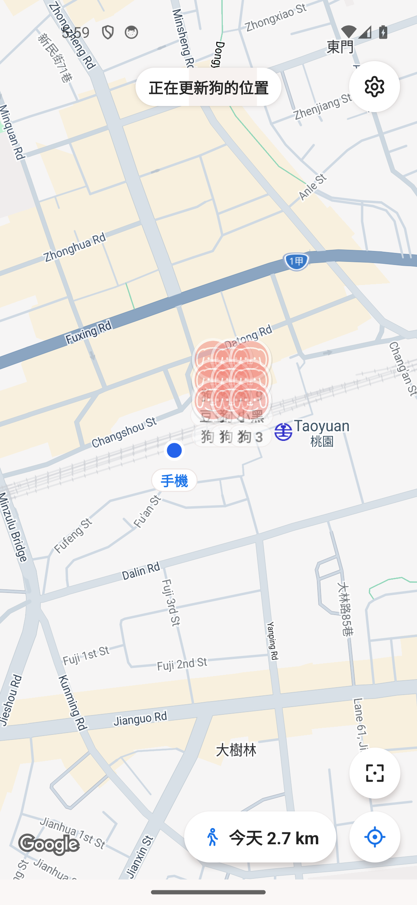
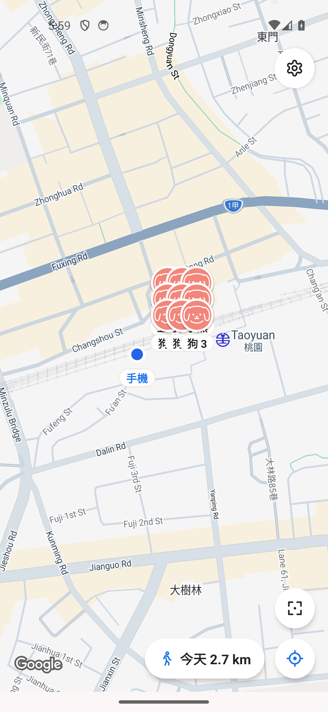
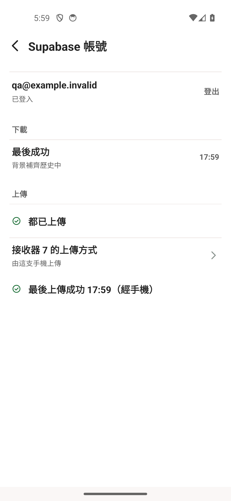
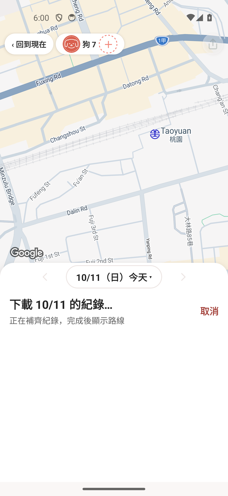
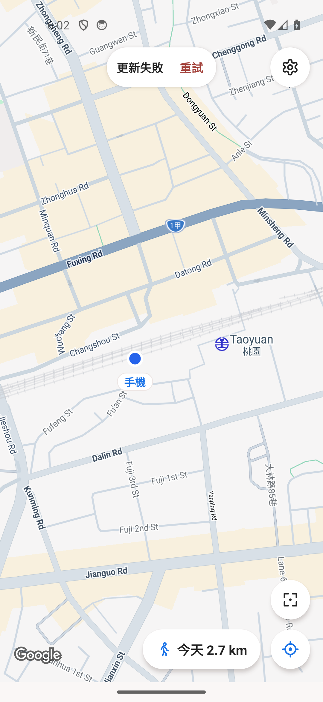

# 最新位置先套用：驗證紀錄

原標題：`fix(history): 下載完成後喚醒讀取，修正歷史持續載入`。前一公開 head 為 `91e7b1be`，PR 仍 Draft；本輪最新產品整合為 `60434279`（前一368b3976原生證據另列）（以下較早原生證據另列為6d47f23f）。此紀錄隨同既有 PR 114 更新。

## 目前確定的來源與程式證據

- 最新60434279完整 Jest：230 suites／2,616 tests PASS（167.989秒）；新增／修改檔案lint 0 errors／0 warnings；產品Release22秒成功。前一368b3976為229 suites／2,610 PASS163.768秒、Release19秒。前一6d47f23f完整228／2,601 PASS164.906秒、Release24秒，非混用驗證結果。
- `CloudLatest.js`：單一serial next-key完整發現，與最多2個dog job重疊；每job兩個clock，含1個keyseek的正常單次最多5條請求。保留packet後fix的順序、silent dogs及獨立舊版54筆比對；全成功才依發現順序原子回傳，任一key／dog／owner check／cancel失敗拒整批。若 transport 忽略 AbortSignal，只能保證晚回不被接受，不能承諾實體 HTTP 立即停止。
- `CloudLatestSnapshot.js`：metadata-only 不解碼／升級 context；positions-only 以同一 joined statement 取得版本、封包與有效定位，保留成功空快照。原完整離線讀取仍保留。
- `useCloudDogs.js`／`CloudPublication.js`：已接受快照只對同 owner／scope／generation／attempt 有效。Optional context 不排在最新位置 consumer 之前；延後成功／失敗不能覆蓋新結果。相同完整 packet+fix 才保原錨點，修改資料重新判斷；純 BLE 資訊保留。
- `useInitialLatest.js`／`hideSplash.js`／MapScreen：失敗或 10 秒 timeout 自動解除新增 latest wait；原本 local／auth／map-frame／link 閘門仍 AND。沒有 Splash 新增面板／按鈕；地圖使用既有 failure pill，後續真正接受同範圍快照才清除。
- local-first 初始化／retention 窄修：先完成真實本機初始讀取，不偽 ready；無實際 eviction 時避免無用 correlated scan，有 eviction 時仍同 TX 失效完整性證據與刪除。
- 歷史的 fresh read／durable coverage、pending／cancel／error 與匯出限制仍保留；latest success 不證明全日歷史完整。

## 5554 真實 Supabase 驗證：較早6d47f23f

產品6d47f23f，私有診斷05c35db9，原完整產品tree與私有版只差既有固定整數probe（精確tree比對已核）。產品APK SHA b2c5c374d42433c3cf1e75a9fc201ce07952284c7f7bc802e2bf6b4c1cfc9fb0；實装診斷APK SHA e424fa82f10cb0f8a69e9e2b360ea896d81840dd2ccb89ca7acdcbfc47f92d6a，單一PID26913。原帳號／快取／無線維持，不製造撤權或無快取。

- 冷啟動四個實際取樣窗口28.913／54.287／92.597／120.826秒。最後同attempt1 proof1、owner／scope／generation相符，latestApplied1、archivePending1、mapBusy0。主視窗親看後續fresh原PNG：正常地圖、無「正在更新狗的位置」。不把晚取樣當離開Splash的精確耗時。
- 同PID真正Home後，實際38.396秒返回。返回前與返回後白名單數字分別保存，返回後新attempt5在5秒目標取樣（實際9.396秒）及20秒仍snapshotPending1、proof4不合、mapBusy1；50秒取樣為attempt5/proof5、latestApplied1、archivePending1、mapBusy0。主視窗親看fresh原PNG，更新提示已消失。不能把50秒取樣說成精確完成時間，也不能冒用背景前proof。
- strict collector只保存七種固定schema／integer、exact PID／INFO，四cold及三resume窗口headerRejected0/schemaRejected0；沒有持久保存raw log、ID、帳號、位置或錯誤字串。真帳圖與完整數字序列僅私有。
- 已確認最新位置實際套用後不再被背景archive拉回busy。冷啟動及resume速度仍有問題，尚未聲稱全面修好。最新原生歷史 loading／完成、離線／恢復與新效能候選的驗收仍待補。

舊1222、53ff、1cc等來源只屬歷史驗證；上述當輪結果也不能自動替後續source候選背書。

## 新368b3976驗證狀態

已有全部10個索引的cold open，固定schema lookup與短no-op batch讓11次native往返減至2次。任何索引缺少保留原11條個別DDL順序／retry，多1個schema lookup；真正建立索引不變成一個長BLE鎖交易。全部SQL定義逐字一致，真SQLite schema/query plan/duplicate failure/partial retry/同連線鎖反例通過。它不改善同PID已初始化的resume。

私有ebc06881與產品368b3976只差原固定integer probes，exact tracked tree比對已核。私有Release19秒成功、APK a74d34967d1e765801482485e95a801cb9cd9a3dd5f774692b45de1bbc2f8b06；新版真5554同PID28057實測：

- 冷啟動四窗實際26.457／52.855／108.884／121.627秒，最後attempt1仍未取得同次快照proof。Splash的10秒最新資料等待已逾時並依設計進地圖；這是新增等待的fallback，不表示網路已報錯或整個同步被取消。主視窗亲看fresh正常地圖、無Splash新按鈕；不能把此窗口算最新位置成功或冷啟速度通過。
- 同PID實際Home30.620秒後返回，新attempt6在5.007與20.009秒仍等待，50.010秒取樣已同attempt6 proof6／owner／scope／generation相符、latestApplied1、contextPending1、mapBusy0。主視窗亲看fresh地圖無更新提示：最新資料套用後已解除等待，室內context繼續背景處理。完成在取樣窗口之間，不能稱精確50秒完成。
- 此版本的實際resume速度仍不符合期望；查詢重疊不能被當作全部慢窗已修。共用資料庫必要讀取的排隊正在另查，原生長工作、HTTP／事件迴圈均可能影響，未給CPU或因果結論。

本輪沒有新真實歷史全流程／離線恢復的完成證據，仍維持Draft；不得用較早6d的native結果替代新版所有情境通過。

## BLE 重複 schema 初始化窄修：60434279

同一實際開啟的 connection wrapper 完整完成PRAGMA／index／trigger後，後續BLE顯示讀取不再重做這些檢查。新wrapper、首次未成功setup仍重新確認，不能把Android共用lockKey當schema已ready；context與未快取display寫入仍留在原shared lock。寫入失敗仍重試真正寫入，不把已成功的schema setup一併重跑。

真SQLite暖讀trap＋archiveproof排隊反例先RED後PASS；6個新增guards另涵蓋setup／寫入失敗、新wrapper同lockKey、held context仍阻proof、lateinsert trigger及raw／平滑資料一致。主視窗已讀全部diff及反例，另一Codex獨立review無blocker。這是同連線重複工作窄修，首次完整schema、較大未materialized頁及原生／HTTP等待尚未全解。

604產品APK SHA21d2cadf1767a66159dd1ecdcb73438443cd6f517613132746c602e1e0bcafee。私有bd3e2e15只差原固定integer probes，App.js／src／android exact runtime比對已核、8focused51PASS、lint0／0；Release20秒成功、APK2b2c55beb7a847d2fa9c38ffc87036f32287d1457791202310704a2b0c790422。最新5554已更新，原生冷啟實際122.657秒仍未接受最新快照；Local initialReady12.720秒，完整cloud schema retention執行尚未在此窗閉合。長時間後原固定80筆consumer probe已用盡，不能把舊sample80當新resume成功；新原生PNG擷取20秒逾時，未取得新版畫面通過。僅從同PID未截斷的固定數值publication紀錄看到常見3–10秒、另有29.434／47.516秒慢窗，不能當特定回前景UI或CPU改善證明。前一368結果不得代替新版驗證。

## 公開原生畫面：獨立虛構九隻狗

主視窗已親看以下五張原 PNG。來源是產品368b3976的相同CloudSync／latest query／snapshot helper／useCloudDogs／MapScreen／history流程，私有截圖版只提供獨立九狗資料與記憶體回應控制；截圖 APK 的 Release 建置19秒成功。圖內qa@example.invalid是虛構帳號，未使用使用者CSV、位移後真路線或真帳資料。控制器只釋放回應，不直接寫 latestApplied／mapBusy 或完整歷史proof。

| 最新資料仍在等 | 最新快照已套用，背景仍待補 |
| --- | --- |
|  |  |

接受最新位置後，原更新提示消失、九狗恢復實色。這两張前後圖是功能路徑，不能證明逐影格原子繪製、真Supabase延遲或CPU改善；密集名字重疊仍屬PR113範圍，沒有為截图移動或隱藏狗。

| 背景補齊狀態 | 未知完整歷史 |
| --- | --- |
|  |  |

正式context budget結束後，設定顯示最後成功與「背景補齊歷史中」。實際狗7卡片進入當日軌跡，只顯下載與「正在補齊紀錄，完成後顯示路線」，地圖沒有假路線／停留清單，匯出圖示呈灰。此時UIAutomator未產生有效XML，沒有宣原生點擊匯出被拒的測試通過；disabled與coverage保護另有正式React測試。

同一cold process未釋放最新回應：13秒圖仍狗動畫，較晚原圖才實際正常地圖與「更新失敗／重試」，Splash沒有新增面板。10秒是新增latest條件的等待，不是從process啟動保證10秒進地圖；原資料庫／偏好／登入／地圖框選条件仍保留。這是虛构等待回應展示，不冒稱真離線、撤權或首次無快取驗證。

## 需保留的限制

同連線原生交易／shared slot 仍需正確 drain，不繞過 owner fence；索引、SQL、網路等待與其他慢窗口沒有全面消除保證。068 CPU 尚未完成，wall 觀察不作 CPU／HTTP 因果。First no-cache、撤權／token 過期、多頁取消缺獨立 QA 帳號，不能冒稱實測。私有帳號、位置、CSV／GPX、原生圖像與 raw logs 不公開。

後續只更新既有 PR 114 的繁中 body／報告／經審閱畫面，不新增 PR、不更換標題格式；待每 PR 明確使用者批准才合併。
