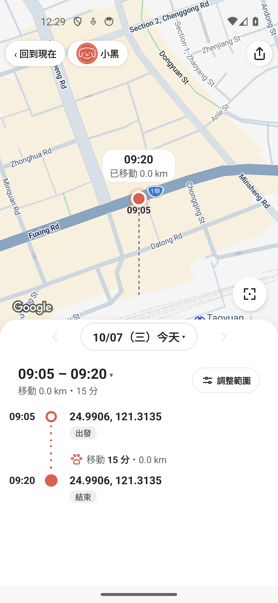
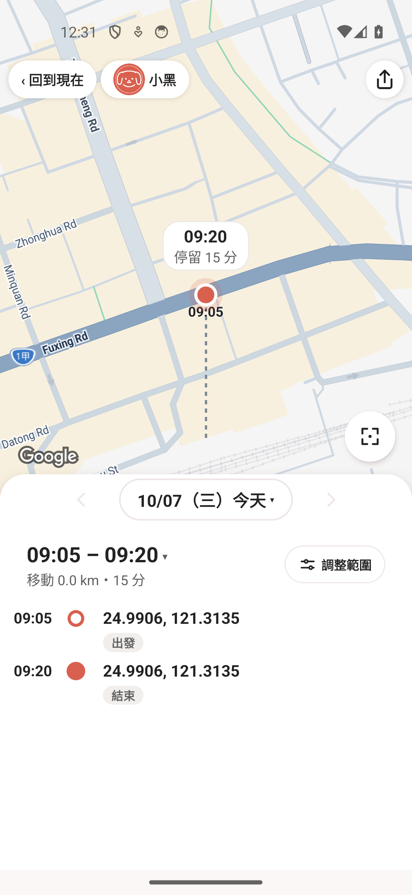
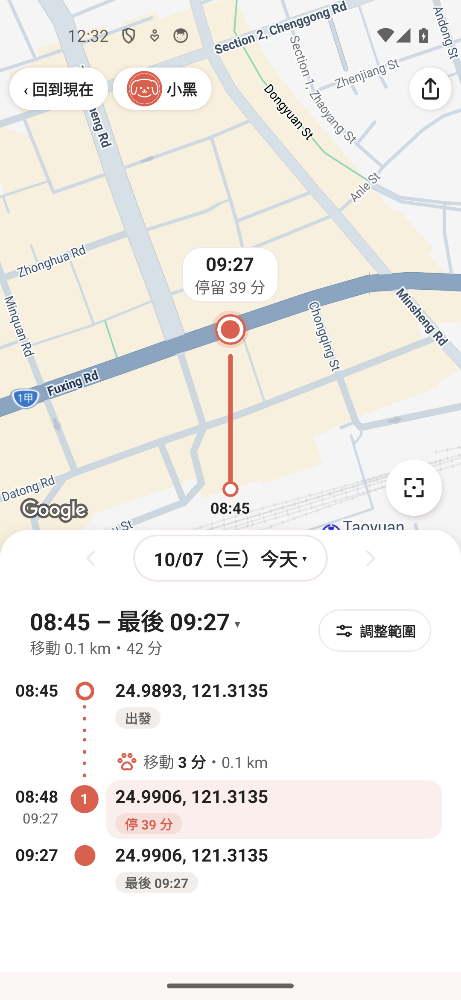

# 狗歷史：裁切既有停留與地圖按鈕驗證

完整一天已確認的長停留，若使用者只選其中一段，原本會失去停留顯示，變成「移動 15 分鐘、0 公里」，游標也寫「已移動」。現在保留這段的停留顯示，游標顯示選取範圍內的停留時間；完整範圍原有的停留編號仍保留。

判斷需要既有長停留與移動邊的證據。實際移動、開車、離開後返回或真正資料缺口仍會阻止套用；沒有足夠證據的短停留不會提升成確定停留。七組獨立虛構回歸包含可能的 20 公尺短走、缺口與完整 CSV／GPX 原始觀測保留。

另修正 Android「框住全部」按鈕超出父容器範圍的問題：改放在畫面同層，維持原視覺位置與面板高度。修正前原生觸控範圍為 `[904,1240][1036,1207]`，上下倒置；修正後為 `[904,1075][1036,1207]`，實際平移後可點擊回到停留點。

## 2026-10-11 原生前後比較

使用 43 筆獨立虛構觀測與既有公開測試地標；沒有轉換使用者軌跡，也沒有寫入資料庫。真記憶體 reader、資料 mapper、hold replay 與歷史 hook 產生畫面。Google 底圖保留標示。

- 前後均有 08:48–09:27 的 39 分鐘停留，選取 09:05–09:20。
- 修正前：清單有「移動 15 分鐘、0.0 公里」，游標有「已移動」。
- 修正後：假移動行消失，游標顯示「停留 15 分」。
- 真正拖動地圖後，按「框住全部」回到停留點。
- 用正常範圍控制拉回完整 08:45–09:27，原停留 1／39 分鐘與前面的 3 分鐘移動都保留。

產品來源 `d5d6387e`：完整 221 suites／2,475 tests 通過，lint 0 errors／8 個既有 warnings；diff check 通過。私有修正前 Android Release 25 秒、修正後 19 秒，5562 實際配對驗證完成。原權限、設定、未登入狀態與記錄開關保留，私有資料入口已關閉，root 已還原正式 main 0.3.163。

公開圖已由 root 逐張檢視。私有驗證入口與資料程式不進產品 PR。此次未驗 TalkBack 焦點，也不宣稱解決狗 6 缺乏活動真值的 GPS 室內分類。PR 須使用者明確批准後才合併。
