# 最新：三段歷史面板與圖示距離摘要已完成普通字體原生驗證

產品db205cda：主視窗完整225 suites／2529 tests PASS187.483秒，Release19秒成功。既有5562 exact同來源私有d1候選已完成首50%、收合日期列、兩次重新上拉展開、收合／展開兩種日曆往返、半高清單捲動、狗爪與車程摘要、範圍shimmer／放開／返回及匯出入口。Root親看原圖與两影片全部88＋131原生影格。實測展開距上方控制20dp。最新證據在本文最後的「最新三段面板原生畫面」；以下先前來源／原生失敗均保留為歷史，不替代新結果。

FontScale2的半高、展開、捲動到完整終點已實際完成，原PNG顯示現在・停7分與四行地址完整在導航上方。大字收合、TalkBack及橫向尚未在本次原生驗證，不以來源檢查冒充。測後已還原原163／font1.0；9项設定presence、6項授權flags、viewport及APK逐項相同，freshPID正常Live。Root親看設定未登入、手機開關checked但GPS未允許與正常地圖，沒有把checked當實際GPS記錄。PR115未merge，等待使用者審閱。

---

# 最新追加：三段面板與圖示距離摘要（原生驗證中）

產品候選affe69f2（b356f161＋aee159ec）已完成主視窗225 suites／2527 tests全測，186.159秒；修改檔lint 0 errors／warnings，arm64-v8a Release19秒成功。原先完整檢查的三套舊摘要／翻譯契約失敗已修正並保留紀錄，沒有放寬全域翻譯規則。

- 新進歷史為50%；日期列下拖收至只留日期，上拖展至「回到現在」實測控制範圍下方留16dp。切日期保留所選檔位，換對象／帳號／新進歷史回50%，旋轉／大字按目前視窗重算相同檔位。
- 日期列的垂直拖曳與清單捲動、時間範圍的水平把手分開。日期按鈕也提供無障礙展開／收合動作，原開日曆及前後日期保留；來源檢查不冒TalkBack原生驗收。
- 摘要顯示步行／狗移動圖示與距離，另列開車／坐車圖示與距離，移除總時間。步行沿用原model.distanceM，車程沿用已分類sections，缺口／不確定資料排除；不修改GPS／分類／原始資料。

產品APK SHA a38839c53996440c231ed8b135d22a0b401cdb13550dda8495ccfa95b668a55d；私有同源52c23821展示APK SHA2f7ee4b893ed3049cf43629423a3ca4c25b04b9a5b765a4e6d5d98531440a632。只用獨立虛構手機240筆與既有虛構狗序列，三高度、保日期、實際控制間距、手勢及狗摘要正在既有5562驗證。下方四項排版／shimmer圖片屬較早版本，不代替這次三高度／摘要通過。PR115未合併，等待使用者看新版證據後決定。

## 首次原生失敗與修正後重驗

首版2f7在5562實際看到50%入場、下拉日期列及狗爪／車程距離，但下拉後再上拉失敗；面板停在中間高度，不能當展開成功。第一個move令日期responder原生節點重建，手勢失去release。產品8543bc01／db205cda保留相同日期host；量測日期／上方控制高度不取消正在拖的手勢，拖動時即顯示內容。新增實際Screen反例涵蓋首move、連續move與量測變動，59focused通過；修正後主視窗完整225 suites／2529 tests通過，187.483秒。

最新產品db205cda Release19秒成功，APK SHA3eaf9012e367f75dbededa62ea7d5d679f5f891e5b8e599e86e23346a1407bd8、ZIP完整。私有d1c6a08d候選Release17秒成功，APK SHA6db96af4ba81d4c86ff0dca86f5b61bf0cfcb0f106f90261b931c33b408c03bb；先前兩次ENOSPC建置失敗保留，清理未使用建置中間檔後重試同SHA。私有新增前日3筆獨立資料讓真日曆可驗，今日240筆及完整model指紋與原fixture完全相同。最新三高度反覆上拉／保日期／控制間距正重驗，未以來源檢查或舊圖列原生PASS。

---

# 歷史清單改版驗證

產品候選24e0e740（主分支整合e876a785），基於已核准main274759f2。移除畫面「我的路線」、座標與停留結束小字；步行及車程圖示在左線中央，停留膠囊放在地址前，支援長地址／大字換行。相鄰步行僅呈現合列，保留真停留、缺口與開車邊界；GPS弱不單獨列出。PNG時間軸同步，CSV／GPX與模型資料不改。

範圍重算先進載入状态，暫停顯示舊結果與匯出；較晚只處理最新要求，換日／返回／帳號切換取消舊要求。來源與hook反例通過，首版真範圍影片已看到載入首幀，但載入期間仍見殘留線；source發現拖曳尚未結束就多次發布preview的路徑，已改為手勢期間持續載入、把手即時移動，放開後才算最後範圍。真正hook反例及兩種畫面layout皆驗；新版普通字體原生影片已錄製，證明長手勢保持載入／把手移動，放開後更新一次；初始及完成／返回的原生畫面接界仍有載入與線共存，不宣稱全部pending畫面空白，也不能以32ms排程或這段影片當作CPU／100ms驗收。

## 驗證

- 主視窗最新完整223套／2503項測試通過，164.077秒。首輪舊UI及同步範圍契約失敗已保留紀錄，修正契約後重新全測。
- 已建置原生Release產品與相同來源的隔離展示版；展示版只在私人分支，未納入PR。最新拖曳展示APK SHA baf643ebbb139999d56b746855e5265a96001014dcfa981c833993a1f5460100，Release19秒實際成功。
- 私有10/10實際5067筆回放，15:25–15:43原六段相鄰步行變一列；模型、CSV、GPX、PNG地圖逐一相同。不公開使用者原始位置、CSV或實際路線。
- 下圖完全獨立虛構240筆桃園場景。改版前三段步行（4／5／3分鐘）合為一列11分鐘，保留三個算法停留及3分鐘車程。算法停留不是人類真值。
- 改版前冷啟動曾出現原生ANR，按一次系統Wait後恢復，才拍正常比較圖；原失敗圖與紀錄私人保留。該問題沒有因截圖恢復就被算作已修復。新版普通字體拖曳及返回已有實際證據；大字末列仍未通過。

## 前後畫面

| 改版前 | 改版後 |
| --- | --- |
| 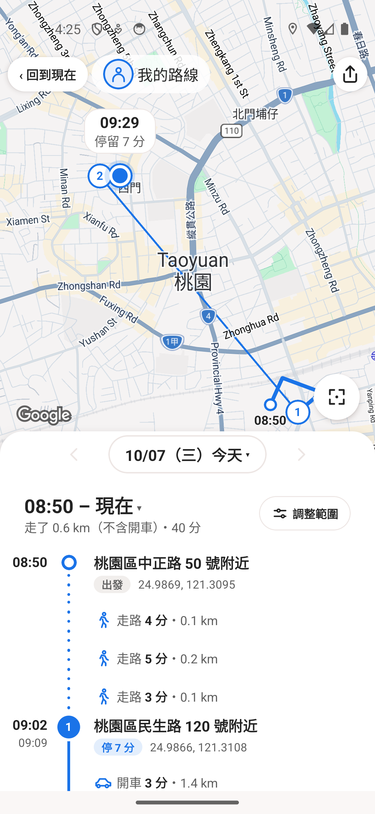 | 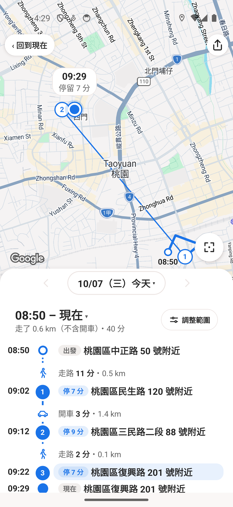 |

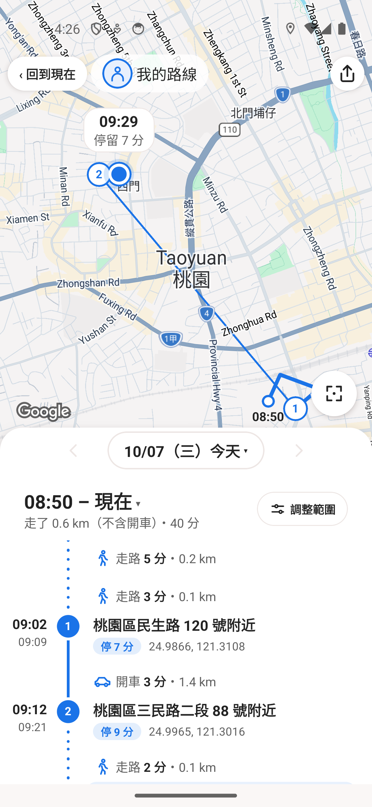
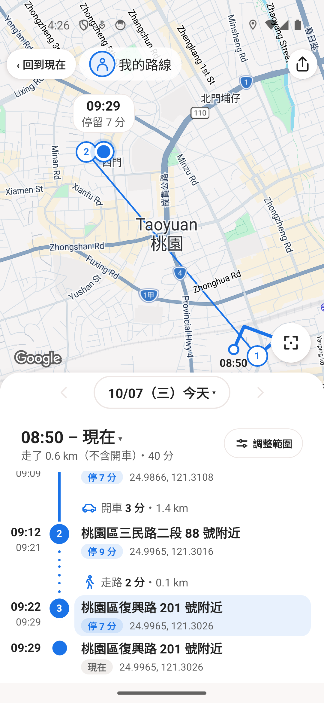

本PR未合併；使用者看圖與操作證據後才決定。

## 大字體與裝置狀態界線

5558 fontScale2原生畫面證明長地址及前置膠囊可換行；末列驗收被System UI ANR阻擋，未列通過。字體、設定、授權及正式164已還原，既有5558重開一次仍有系統ANR，不能稱正常live閉環通過。既有5562已正常啟動及讀回原163設定，接續用相同虛構資料驗新拖曳；未建立新AVD，未清資料。

## 最新普通字體原生證據

最新after-top及下方新圖／原影片來自既有5562，產品24e0e740＋私人展示8bdcda6b，APK SHA為上列baf643…，installed SHA與單一App PID在操作前均實核。展示四個runtime檔案和前一私人展示e70f逐byte相同，沒有匯入真CSV或原路線形狀。Private展示來源不在此PR。

既有三張before-top/mid/end仍來自5558的舊版基準APK7ec2e889…；先前after-top曾來自同台首版UI APKb16b1c0c…，這次換成最新baf643…原圖。這是相同獨立虛構資料的UI對照，**跨裝置，不能當效能A/B**。公開PNG是原screencap或原影片直接解碼frame，沒有裁切、拼接、修線或合成。manifest提供各檔SHA。

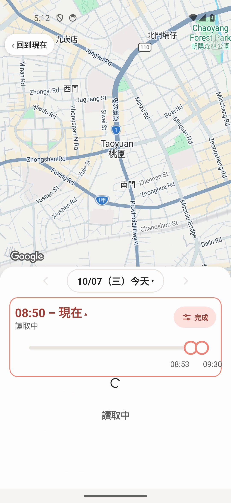
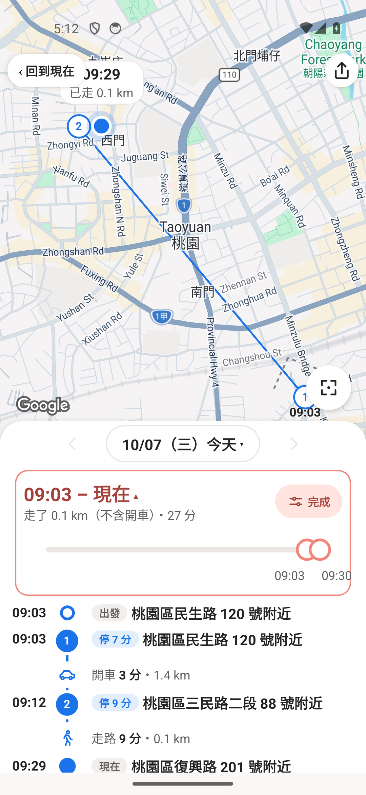
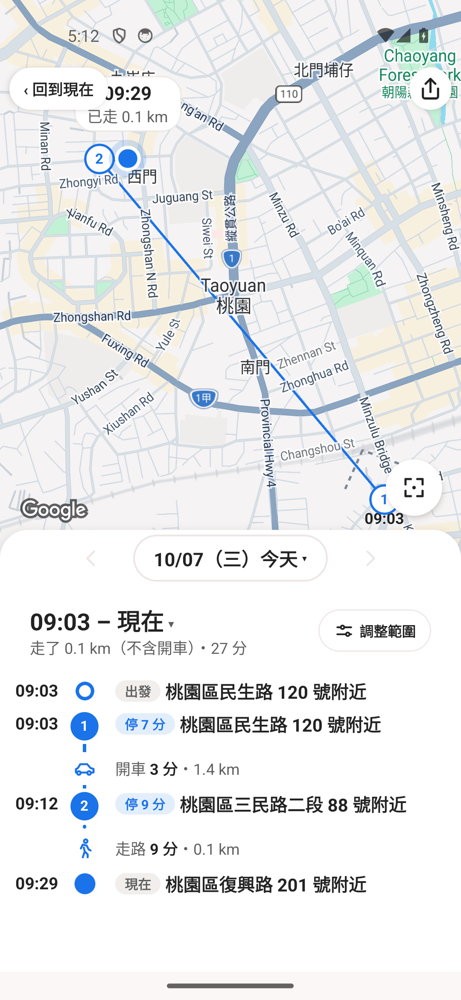

[原生普通字體拖曳與返回影片](evidence/history-timeline-compact/after-held-range.mp4)

錄影指令15秒，原檔8.8383秒／112個原生frame；後段畫面靜止沒有新增frame，沒有補幀或偽填時長。第一手勢3500ms向右移動，local把手08:50逐步到09:03，長held主段維持讀取中，清單不重現且map route被清除。放開後只出現09:03結果、匯出恢復；第二手勢的local把手到09:05時按Back，未完成的範圍被取消，最後清單及摘要仍是09:03，沒有其後09:05結果回填或重新開把手。最後XML確認無loader、export enabled／clickable、rangebar不存在且無ANR。

**界線仍保留：**初始busy、放開及Back的相鄰原生frame存在spinner與route短共存；影片不能證明所有pending原生畫面同時空白，也不能單憑這點歸因Google SDK。沒有觀察到手勢中途新清單或錯誤範圍發布；它不等於對所有資料或nativepaint作普遍保證。只有一個240筆功能場景，沒有CPU、100ms點線或真資料吞吐驗收。主視窗已親看完整112 frame／PTS的四張私人QA contact及原PNG，確認09:05取消未發布；以上原生接界及大字失敗限制仍保留，不標為全原生ready。

5562原本Supabase未登入，recording開關ON但定位權限未允許；這些原狀保存，沒有為測試新增permission。此次未改字體／主題／無線／viewport、未清DB/auth/cache、未新建AVD。5558及fontScale2的System UI ANR限制仍如上，不因這次普通字體成功而刪除。

## 測後恢復

既有5562已保資料還原原版0.3.163，installed APK SHA640463a5e8ff5955830e2106d3fb97d790ebd6322b24cb395ad36262238f51fa逐一核對。九項原設定（含fontScale1.0、主題、無線）、viewport與六項permission grants／flags均和測前完全一致。實際設定頁仍Supabase未登入、位置紀錄開關ON且定位權限未允許；返回正常live地圖，XML及原PNG均無ANR，單一App PID5563。沒有清資料／快取、沒有改帳號或AVD；原版恢復圖只在私人驗收目錄，不混入改版公開證據。

## 使用者第二輪審閱修正（新版原生驗證中）

時間軸移動列最少56dp，20dp圖示及28dp遮底上下各保約14dp連線；PNG移動列最少168px。右上匯出原glyph保留，44dp圓底／28dp圖示／48dp有效點按區；通用chip仍原hitSlop，匯出選項未改。範圍載入改用既有LoadingContent時間軸shimmer（300ms後出現、reduce-motion及cleanup原樣），載入禁止匯出與舊模型的語義不變。

最後原stop/end相鄰、stop.end等於end.start、代表座標完全相同且無gap時，僅清單與PNG合成單一終點；留時長／地址／停留start及原now／last／closed／跨日label。不同位置、時間、gap（包括被隱藏的GPS弱row）、末尾真移動均不合。不改raw/model/map停留數與CSV/GPX。完全相同私人240點nativefixture實際production回放：10source nodes→7display nodes，末端原stop3／end合一，420000ms停留保留，model JSON完全不變；私人fixture程式未納公開分支。此結果不代替56dp視覺或新版native shimmer驗收。

主視窗產品be1554b9已重新完整223 suites／2515 tests PASS（166.13秒），產品Release22秒成功，SHA b5dd4b5783f7cbe6398ffd46df514e11370c9cd6ec204aead24bf3935897147e。相同240点私有0e204cb8只差原四個展示入口檔，Release20秒成功、APK dc43f82029abd1ab90960f34d911d2c326c64e3332b498e95787123f054eac35。既有5562正在真正原生驗證，以下前一輪24e圖片／影片不能代替四項新尺寸及shimmer通過。

## 第二輪四項新版原生證據（5562）

0e204cb8／APK dc43／PID9436真正裝到既有5562，正常字體原圖證明車／走路圖示上下連線可見、原匯出圖示加大；同址末stop3/end已合成09:22一列「現在・停7分」，地址及整列完整。今日仍用「現在」，歷史結束及PNG保原「結束」語義。

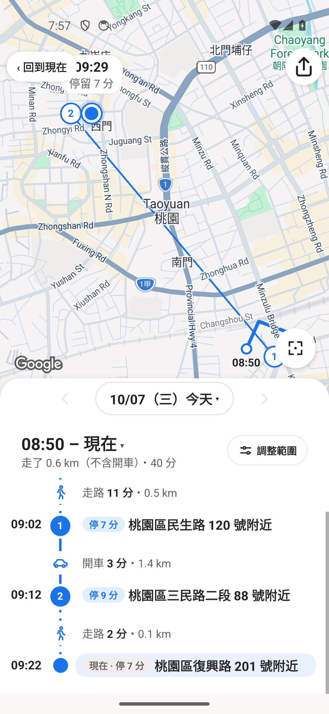
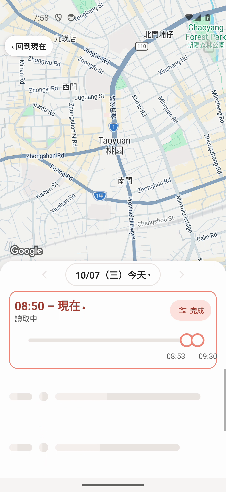

[新原生操作影片](evidence/history-timeline-polish/held-range-back.mp4)：9.4243秒、115原生frame，主視窗已親看全部及原圖。長按拖動主段是既有時間軸shimmer、無轉圈／旧清單；放開後09:03範圍及匯出恢復，下一次09:05途中Back取消、最後仍09:03。初始2–3幀舊底圖線短留、清單已空，不宣全nativepaint原子更新。09:03子範圍原模型末段判為9分鐘走路，無7分鐘停留；未借全範圍圖冒充所有range的分類，GPS/model演算法未改。普通字體末列通過；font2只有中段地址換行有效，末列未證實，誤觸Home後的launcher圖已排除。

測後原163 APK640463a5逐SHA還原／PID11348，9設定presence與value、6permission grants/flags、viewport逐一相同；設定未登入、位置紀錄開關ON但GPS denied，最後正常Live／無ANR，全部worker關閉。沒有新AVD或清資料。

使用者接著要求三段可拖面板（新開50%／縮至日期列／上展至回到現在下方留空）及圖示距離摘要（移動＋車、去掉總時間）；另在相同PR115實作中，本節四項原生證據不代替接續版驗證。

## 最新三段面板原生畫面

最新產品db205cda＋私有d1c6a08d（同來源UI、APK6db96af4）在既有5562實際操作。主視窗已親看以下四张原生原圖及影片全部88個影格：50%入場、下拉日期列、上拉展開、再次收合與再次上拉，兩次展開都穩定panel top334px。上方控制可見範圍底279px，實際差55px／density2.75＝20dp，保留要求的16dp以上間距。

| 進入50% | 下拉只留日期 | 上拉展開 |
| --- | --- | --- |
| 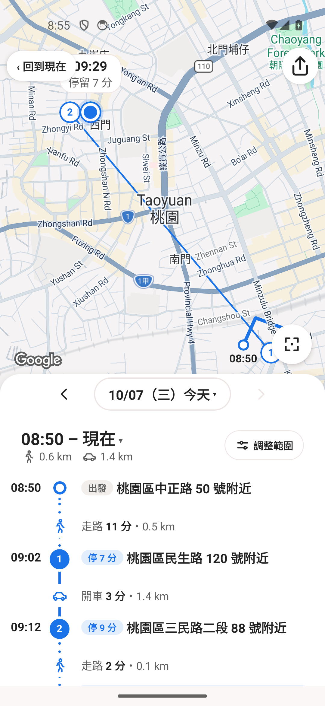 | 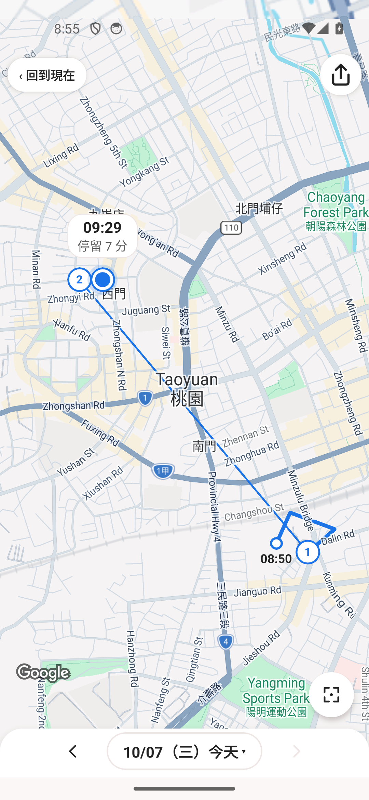 |  |

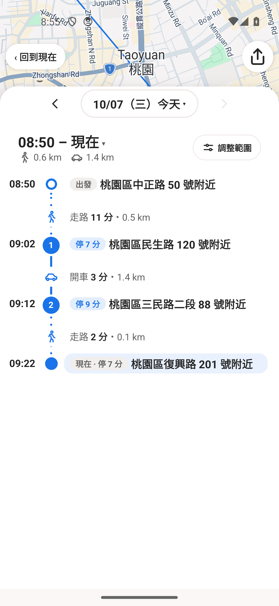

[實際拖曳影片](evidence/history-sheet-summary/three-snap-drag.mp4)：原檔14.085767秒／88個原生影格；錄影要求15秒，未補幀。第一輪50%→收合→展開→再收合已入影片，第二次上拉發生在錄影結束之後，使用上圖與操作紀錄證明，未稱影片包括第二次上拉。影片只作功能證據，不作流暢度／CPU驗收。

日期往返已實際用日曆：收合時10/07→10/06→10/07都維持top2131；展開時同一往返都維持top334。半高清單真捲動後日期列及panel維持原bounds，末列由nav以下移至完整可見；沒有把內容原本全fits的展開滑動冒充有效捲動。

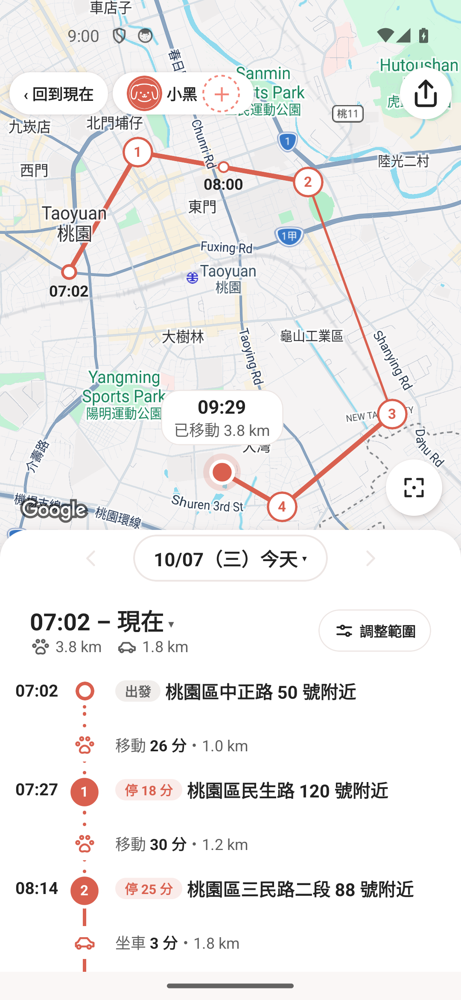

狗用既有獨立虛構BLE序列，由正式reader／model得到兩個距離；fresh啟動仍半高，無總時長。最新同APK範圍影片9.420111秒／131原生影格主視窗全部親看：held時既有shimmer、放開09:03更新，第二手勢途中Back仍保留09:03。動畫接界／pending時地圖可能保留原線，未宣全pending原子清空；無spinner，不作CPU／流暢度A/B。完成後實際點原匯出入口顯示三格式與六動作，未發送／下載。

[最新同APK範圍拖曳與返回](evidence/history-sheet-summary/range-held-back.mp4)
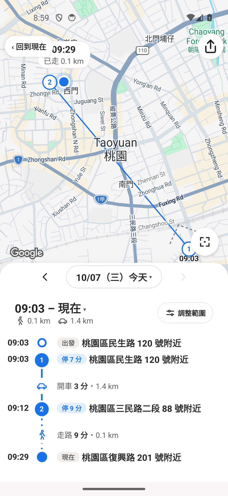

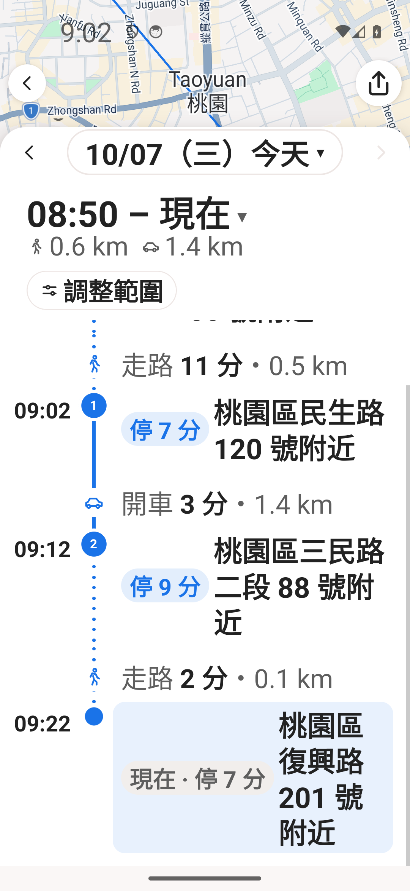

## 2026-10-12 接續來源：拖曳提示、裁切停留與地址狀態

來源 b0834323 與 bd9ad7a5 已凍結；此節為來源／focused 結果，尚未宣稱新版原生通過。247 private APK 的固定提示留白已被使用者否決，該輪截圖不作新設計驗收。提示改為把手上方 transient HH:mm overlay，允許短暫疊到摘要；按下／拖中／放開的 bar style 一致，不新增高度，提示放開收起。原 map label 拖中隱藏仍保留 bitmap 尺寸／anchor，避免同一時間兩個重疊 label。

裁切起點只有屬於已判定 visit（id）且原 fix 的時間及座標精確屬於該停留，才可合併成出發；地址相同、GPS 距離接近、弱訊號或缺口不足以證明同一停留。只合併呈現，raw fixes、model、CSV／GPX 與公里不改；地圖也移除該合併初始／末端 stay 的重複編號，中間編號不重排。map hidden 邊界按不可變 model.nodes 快取，游標 move 不重跑合併。清單、map a11y、cursor 的分鐘 copy 共用；觀測中斷仍保留原有效 duration，不把缺口補成停留。

247 狗圖沒有地址的原因已查明：private fixture 共用 8 筆答覆（包含刻意 null），狗6查完再切狗4耗盡，後續 state=none 而非仍查詢中。新版 private 3a02bc71 在兩 scene 使用 64 筆明確「虛構測試地點」，仍走真正 addressLookup pipeline；第二狗每個地點都查到，不碰真 cache／SQLite。產品本身 pending 使用 inline Skeleton，none／逾時顯示 c1256「地址暫時無法取得」，found 才顯示取得地址。膠囊與 dot 用 cardTitle.lineHeight × 實際 fontScale 的共同首行 wrapper 置中；不按整個長地址段落置中，也不用固定 1／2dp 補差。

Focused：8 suites／150 tests、4 suites／48 tests、private 1 suite／6 tests 全 PASS。後兩者包括正確字串 lookup contract、fontScale 1／2、pending→none→稍後找到、兩有效狗6→4查地址。ESLint 0 errors／0 warnings、diff check通過；全部有限worker已關場。新 artifact 安裝、原圖與全部影片 frame 的主視窗親看另行補證，沒有把 fixture 視覺驗證當成 Supabase／GPS／CPU 通過。
